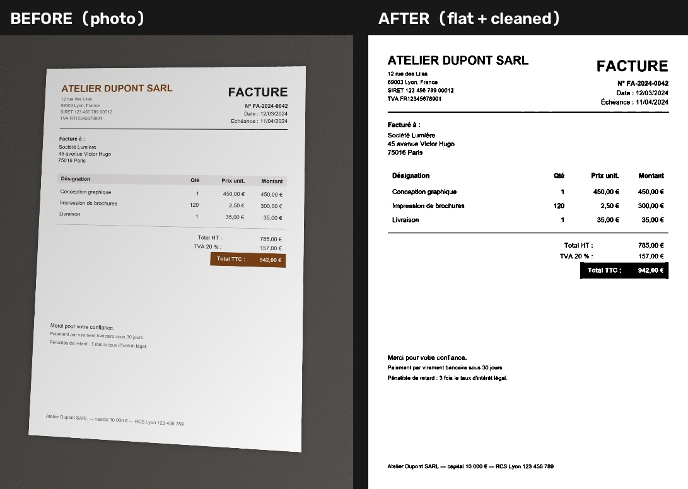

# Smart Document Scanner + OCR

Turn a phone photo or a PDF of a document into **flat, clean text and structured
fields** — fully locally, with no cloud OCR, no API keys, and no model training.

The project detects the sheet of paper, fixes perspective, removes shadows and
noise, runs Tesseract (`fra+eng` by default, `ara` optional), and extracts the
date, document number, name/organisation, and total from French invoices,
French administrative forms, and English receipts.



## What it does

```text
photo / PDF
    │
    ▼
scanner.py ── detect page corners → perspective warp → denoise → CLAHE → adaptive threshold
    │             (also prepares an illumination-normalized grayscale copy)
    ▼
ocr.py ────── Tesseract (fra+eng) on binary, grayscale, and normalized copies
    │
    ▼
extract.py ── conservative regex/rules → date, number, name, organisation, total
    │
    ▼
JSON + CSV (CLI)  /  JSON response (FastAPI)
```

- **Scanner:** Canny + Otsu contour detection, four-point perspective transform,
  grayscale, non-local-means denoising, CLAHE contrast, adaptive thresholding.
  It also prepares an illumination-normalized grayscale copy for difficult
  phone photos.
- **OCR:** Tesseract 5. The binary, grayscale, and illumination-normalized
  versions are OCR'd, and the stronger result is kept. Per-word confidence and
  bounding boxes are included by default.
- **Extraction:** accent-insensitive, label-aware rules. Missing fields stay
  empty (`""` / `null`); values are never invented.
- **Inputs:** JPG, PNG, BMP, WEBP, TIFF and PDF (rasterized at 200 dpi with
  PyMuPDF; no Poppler needed).
- **Outputs:** JSON, CSV, cleaned page images, before/after comparison.

### Verified sample results

| Sample | Type | Date | Number | Name / organisation | Total | OCR conf. |
|---|---|---|---|---|---|---|
| `invoice1.jpg` | invoice | 2024-03-12 | FA-2024-0042 | ATELIER DUPONT SARL | 942.00 EUR | 94.6 |
| `invoice2.jpg` | invoice | 2024-05-28 | 2024-078 | MENUISERIE BERNARD | 9018.00 EUR | 94.1 |
| `form1.jpg` | form | 2024-04-05 | DOS-2024-1187 | Camille Martin / PRÉFECTURE DE LA GIRONDE | 25.00 EUR | 95.1 |
| `receipt1.jpg` | receipt | 2024-06-18 | R-10458 | BLUE HARBOR CAFE | 24.75 USD | 94.3 |
| `invoice1.pdf` | PDF invoice | 2024-03-12 | FA-2024-0042 | ATELIER DUPONT SARL | 942.00 EUR | 94.7 |

All names, addresses, numbers, and amounts in `samples/` are synthetic.

## Project structure

```text
.
├── api.py                  FastAPI app: GET /health, POST /scan
├── main.py                 CLI: scan + OCR + extract + export
├── Dockerfile              API image with Tesseract fra/eng/ara
├── requirements.txt
├── src/
│   ├── scanner.py          edge detection, warp, denoise, normalization, threshold
│   ├── ocr.py              Tesseract wrapper + availability checks
│   ├── extract.py          rule-based field extraction
│   ├── export.py           JSON/CSV writers
│   └── pdf.py              PyMuPDF rasterization
├── scripts/
│   └── generate_samples.py synthetic document photos + PDF
├── samples/                generated fake documents (committed)
├── tests/                  pytest suite
├── docs/                   README before/after image
└── output/                 generated results (gitignored)
```

## 1. Install Python dependencies

Python 3.10+ is required (tested on Python 3.14 on Windows).

```powershell
python -m venv .venv
.\.venv\Scripts\Activate.ps1
python -m pip install --upgrade pip
python -m pip install -r requirements.txt
```

If PowerShell blocks activation:

```powershell
Set-ExecutionPolicy -Scope Process Bypass
.\.venv\Scripts\Activate.ps1
```

On macOS/Linux:

```bash
python3 -m venv .venv
source .venv/bin/activate
python -m pip install -r requirements.txt
```

## 2. Install Tesseract OCR

### Windows (recommended)

```powershell
winget install --id UB-Mannheim.TesseractOCR -e
```

The UB Mannheim installer normally puts Tesseract here:

```text
C:\Program Files\Tesseract-OCR\
```

If you use the graphical installer instead, tick **Additional language data**
and select **French (fra)** and **Arabic (ara)**. English (`eng`) is included.

If winget installed English only, add the French and Arabic data files
(open PowerShell **as Administrator**):

```powershell
$dest = "C:\Program Files\Tesseract-OCR\tessdata"
Invoke-WebRequest "https://github.com/tesseract-ocr/tessdata_fast/raw/main/fra.traineddata" -OutFile "$dest\fra.traineddata"
Invoke-WebRequest "https://github.com/tesseract-ocr/tessdata_fast/raw/main/ara.traineddata" -OutFile "$dest\ara.traineddata"
```

### Add Tesseract to PATH

```powershell
setx PATH "%PATH%;C:\Program Files\Tesseract-OCR"
```

Close and reopen the terminal. This project also auto-detects the standard
install path, so it works even if PATH is missing. For a non-standard location:

```powershell
setx TESSERACT_CMD "D:\Tools\Tesseract-OCR\tesseract.exe"
```

### Verify

```powershell
tesseract --version
tesseract --list-langs
```

`--list-langs` must include `eng` and `fra` (and ideally `ara`). You can also run:

```powershell
python -m src.ocr
```

If Tesseract is missing, the app **stops with installation instructions** and
never fabricates OCR output.

### Linux / Docker

```bash
sudo apt-get install tesseract-ocr tesseract-ocr-eng tesseract-ocr-fra tesseract-ocr-ara
```

The included Dockerfile installs these automatically.

## 3. Generate the synthetic samples

```powershell
python scripts/generate_samples.py
```

This writes `samples/invoice1.jpg`, `invoice2.jpg`, `form1.jpg`,
`receipt1.jpg`, and `invoice1.pdf`. The images are perspective-warped, shadowed,
blurred, and noised to imitate phone photos. All content is fake.

## 4. Run the CLI

Single image:

```powershell
python main.py --input samples/invoice1.jpg --output output/result.json
```

PDF:

```powershell
python main.py --input samples/invoice1.pdf --output output/invoice1_pdf.json
```

Batch (all images and PDFs in a folder):

```powershell
python main.py --input samples --output output/
```

Optional flags:

```powershell
# Include Arabic too
python main.py --input samples/invoice1.jpg --output output/result.json --lang fra+eng+ara

# Omit per-word confidence boxes from JSON (smaller file)
python main.py --input samples/invoice1.jpg --output output/result.json --no-words

# Single uniform text block (useful for receipts)
python main.py --input samples/receipt1.jpg --output output/receipt.json --psm 6
```

For every document the CLI writes:

- `output/result.json` and `output/result.csv`
- `output/<name>_scan.png` — the flat, cleaned page
- `output/<name>_comparison.jpg` — before/after image
- For PDFs, one cleaned scan per page

CSV is UTF-8 with BOM so French accents open correctly in Excel. JSON is UTF-8
without escaping (`ensure_ascii=False`).

## 5. Run the REST API

```powershell
python -m uvicorn api:app --reload --port 8000
```

Open the interactive docs at <http://127.0.0.1:8000/docs>.

Health check:

```powershell
curl.exe http://127.0.0.1:8000/health
```

```json
{
  "status": "ok",
  "tesseract": {
    "available": true,
    "version": "5.4.0.20240606",
    "languages": ["ara", "eng", "fra", "osd"]
  }
}
```

Scan an image:

```powershell
curl.exe -F "file=@samples/invoice1.jpg" "http://127.0.0.1:8000/scan?include_words=false"
```

Scan a PDF:

```powershell
curl.exe -F "file=@samples/invoice1.pdf" "http://127.0.0.1:8000/scan?include_words=false"
```

Query parameters for `POST /scan`:

| Parameter | Default | Meaning |
|---|---|---|
| `lang` | `fra+eng` | Tesseract languages, e.g. `fra+eng+ara` |
| `psm` | `3` | Tesseract page segmentation mode (0–13) |
| `include_words` | `true` | Include word text, confidence, and bounding boxes |

The API processes uploads in memory and does not store them. Limits: 25 MB and
20 PDF pages per request. If Tesseract or a language pack is missing, `/scan`
returns HTTP 503/400 with the exact fix.

## 6. Run with Docker

Build:

```powershell
docker build -t smart-doc-scanner:latest .
```

Run the API:

```powershell
docker run --rm -p 8000:8000 --name smart-doc-scanner smart-doc-scanner:latest
```

Test it:

```powershell
curl.exe http://localhost:8000/health
curl.exe -F "file=@samples/invoice1.jpg" "http://localhost:8000/scan?include_words=false"
```

Run the CLI inside the image (mount the folders):

```powershell
docker run --rm `
  -v "${PWD}/samples:/app/samples" `
  -v "${PWD}/output:/app/output" `
  smart-doc-scanner:latest `
  python main.py --input samples/invoice1.jpg --output output/result.json
```

On macOS/Linux replace `${PWD}` with `$(pwd)`.

The image installs `tesseract-ocr`, `tesseract-ocr-eng`, `tesseract-ocr-fra`, and
`tesseract-ocr-ara`, so it needs no internet at runtime.

## 7. Example JSON output

Command:

```powershell
python main.py --input samples/invoice1.jpg --output output/example_result.json --no-words
```

Full output:

```json
{
  "source": "samples\\invoice1.jpg",
  "document_type": "invoice",
  "date": "2024-03-12",
  "document_number": "FA-2024-0042",
  "name": "ATELIER DUPONT SARL",
  "organisation": "ATELIER DUPONT SARL",
  "total_amount": 942.0,
  "currency": "EUR",
  "ocr_confidence": 94.6,
  "ocr_language": "fra+eng",
  "ocr_variant": "illumination-normalized",
  "text": "ATELIER DUPONT SARL\n\n12 rue des Lilas\n\n69003 Lyon, France\nSIRET 123 456 789 00012\nTVA FR12345678901\n\nFacturé à :\n\nSociété Lumière\n\n45 avenue Victor Hugo\n75016 Paris\n\nDésignation\n\nConception graphique\nImpression de brochures\n\nLivraison\n\nMerci pour votre confiance.\nPaiement par virement bancaire sous 30 jours.\n\nPénalités de retard : 3 fois le taux d'intérêt légal.\n\nAtelier Dupont SARL — capital 10 000 € — RCS Lyon 123 456 789\n\nFACTURE\n\nN° FA-2024-0042\nDate : 12/03/2024\nÉchéance : 11/04/2024\n\nQté Prix unit. Montant\n1 450,00 € 450,00 €\n120 2,50 € 300,00 €\n1 35,00 € 35,00 €\nTotal HT : 785,00 €\nTVA 20 % : 157,00 €\n\nTotal TTC : 942,00 €",
  "page_count": 1,
  "scan": {
    "document_detected": true,
    "input_size": [1750, 2250],
    "output_size": [1342, 1903]
  }
}
```

If you omit `--no-words` (the default), the JSON also contains a `words` array:

```json
"words": [
  {
    "text": "ATELIER",
    "confidence": 96.0,
    "left": 87,
    "top": 91,
    "width": 214,
    "height": 37
  }
]
```

For PDFs, the response also contains a `pages` array with per-page text,
confidence, fields, and page number.

### CSV columns

```text
source, document_type, date, document_number, name, organisation,
total_amount, currency, ocr_confidence, ocr_language, ocr_variant,
page_count, text
```

## 8. Tests

```powershell
python -m pytest -q
```

The suite covers extraction rules (including “do not invent missing values”),
scanner geometry/cleaning, PDF rasterization, JSON/CSV export, and the API.
OCR/API OCR tests skip automatically if Tesseract is not installed.

## Notes and limitations

- Extraction is intentionally rule-based, not a trained model. Unusual layouts
  may produce empty fields; the code does **not** guess totals from line items.
- `Total HT`, `TVA`, and `Subtotal` are not treated as the final total. A
  labelled `Total TTC`, `Total à payer`, `TOTAL`, or `Montant du timbre` is
  required.
- If OCR puts a labelled total and its amount on separate lines (common on
  receipts), extraction accepts the single unambiguous currency-marked amount
  below the label; ambiguous cases stay empty.
- Dates are normalized to `YYYY-MM-DD`. Birth dates are ignored when a document
  date is present.
- Arabic is installed and testable with `--lang fra+eng+ara`, but the default
  `fra+eng` is more accurate on French documents.
- PDFs are rasterized at 200 dpi. For very small scans, increase the source
  resolution or use `--psm 6`.
- The sample documents are synthetic. No real personal data, secrets, or API
  keys are included or required.

## Troubleshooting

**`Tesseract OCR is not installed`** — install it (section 2), then run
`python -m src.ocr` to confirm. If it is in a custom folder, set `TESSERACT_CMD`.

**`Missing Tesseract language data: fra`** — copy `fra.traineddata` into the
`tessdata` folder next to `tesseract.exe`, then run `tesseract --list-langs`.

**Accents look wrong in the terminal** — the data is stored correctly as UTF-8;
this is usually a Windows console code page issue. Open the JSON in an editor,
or run `chcp 65001` first.

**Poor OCR on a photo** — fill more of the frame with the page, avoid blur, and
keep the page reasonably flat. The scanner can fix perspective and lighting,
not motion blur. Try `--psm 6` for receipts.
